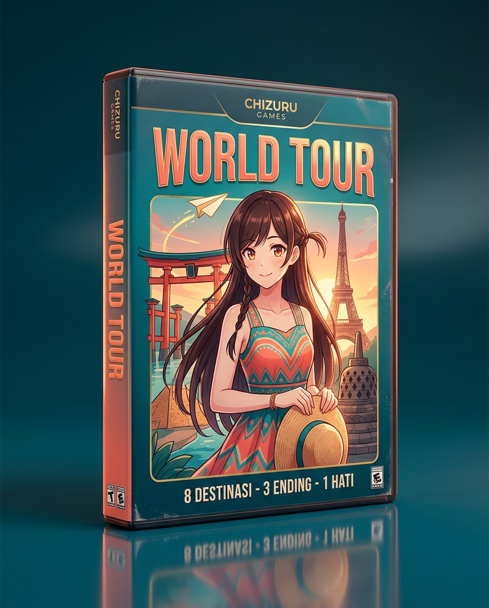
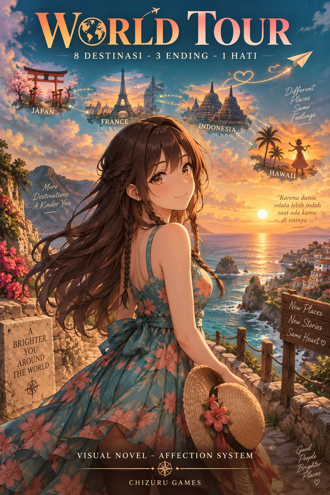
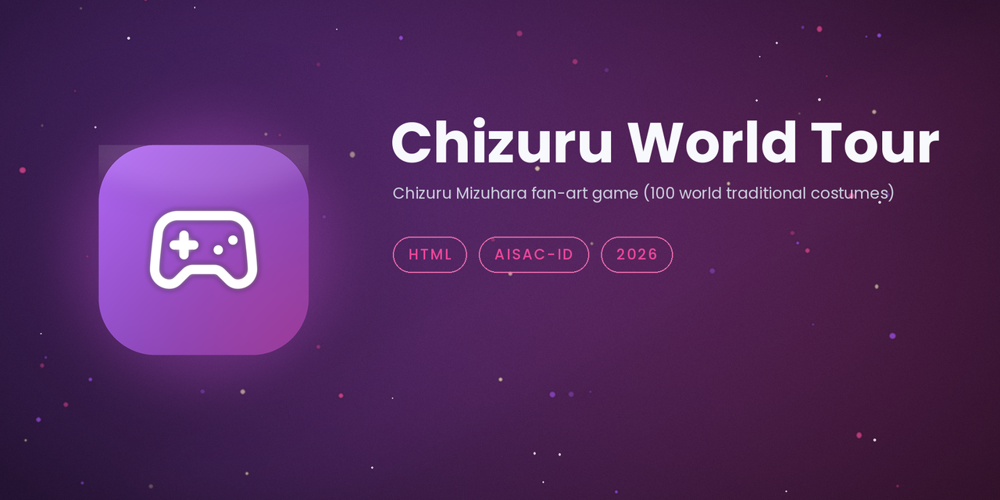
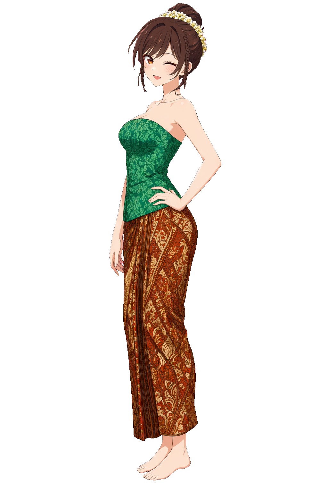
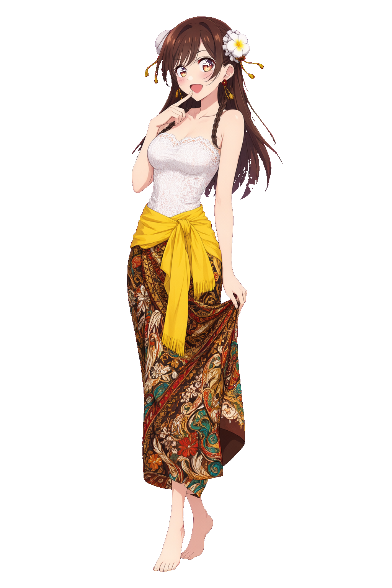
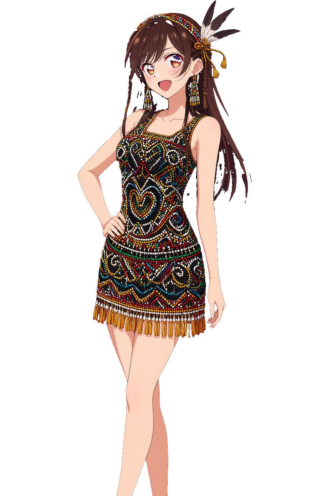
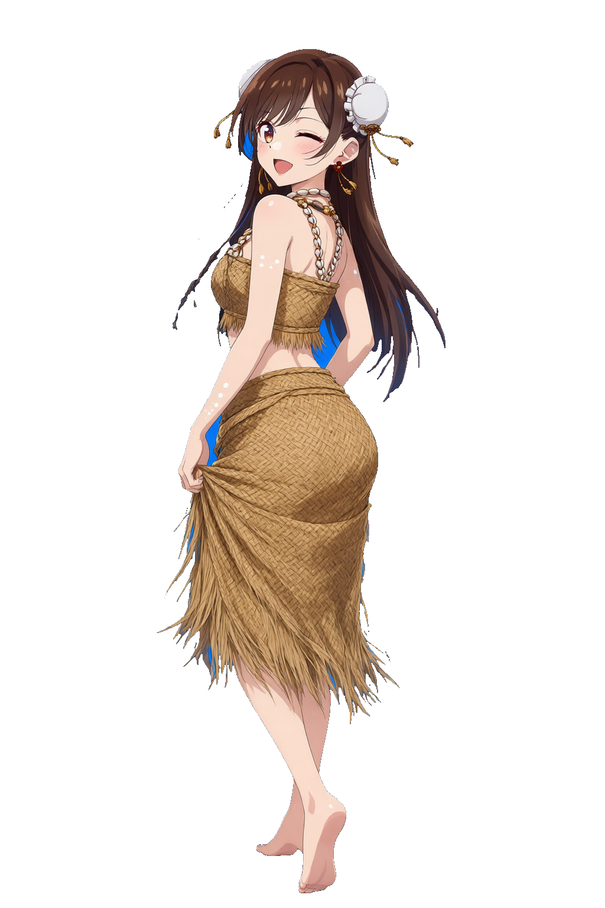

# Chizuru World Tour

| Software Box | Poster |
|---|---|
|  |  |

| Social Preview | Social Square |
|---|---|
|  |  |

Visual novel pendek: jalan-jalan keliling dunia bareng Chizuru Mizuhara dalam 8 destinasi kostum adat.

## Cara Main
- Baca dialog, buat pilihan yang menaikkan/menurunkan affection.
- 8 destinasi terbuka berurutan; affection menentukan ending (TRUE / GOOD / NORMAL).
- Progres disimpan di browser (localStorage).

## Mainkan
https://aisac-id.github.io/chizuru-world-tour/

## Teknis
Static HTML + JS, tanpa server. Buka `index.html` langsung atau via GitHub Pages.
Aset gambar fan-art di `assets/`, brand & promotion kit di `promo/`.
Bagian dari suite **CHIZURU GAMES** (4 game, 100 kostum) — video promo suite ada di arsip promo kit.

## Sprite Kostum

Empat sprite transparan Chizuru di `assets/`, dipasangkan dengan destinasi dan kostumnya di game:

| Yogyakarta, Jawa | Bali | Longhouse Dayak Kenyah, Kalimantan | Pantai Papua |
|---|---|---|---|
|  |  |  |  |
| Kebaya Jawa | Kebaya Bali putih-emas | Kostum manik-manik Kenyah | Rumbai & mahkota bulu bird-of-paradise |
| `sprite-001.png` | `sprite-004.png` | `sprite-015.png` | `sprite-016.png` |
