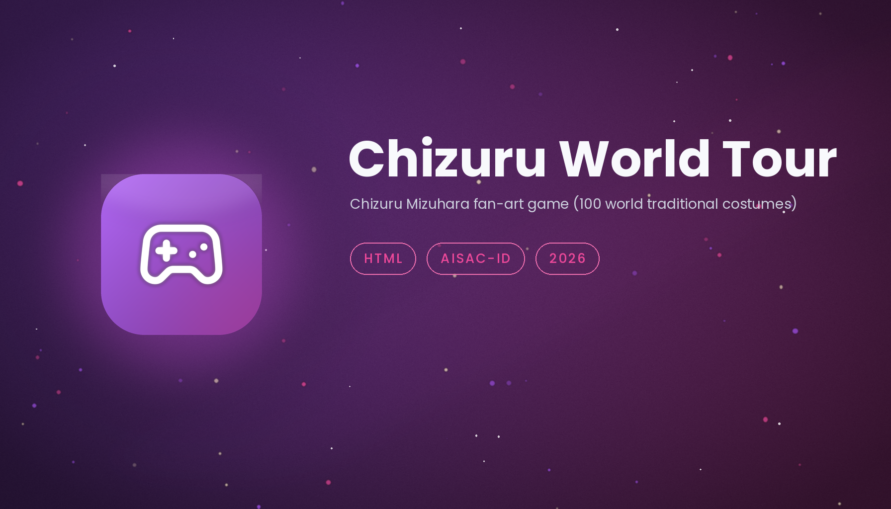
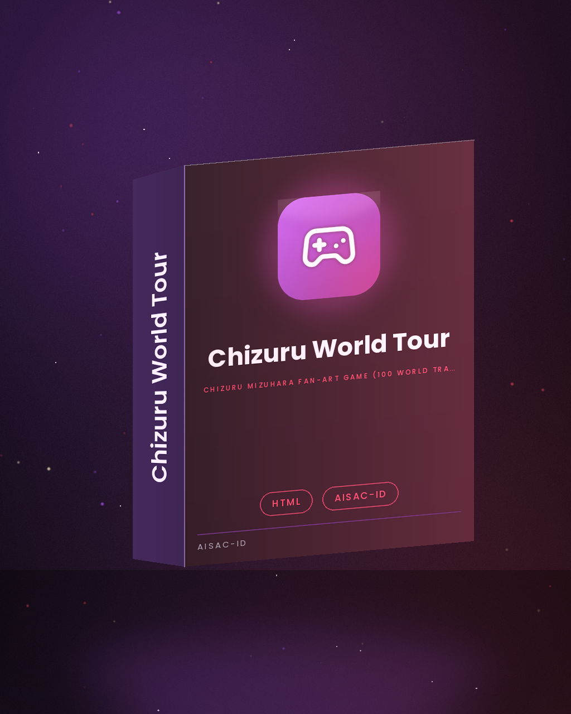
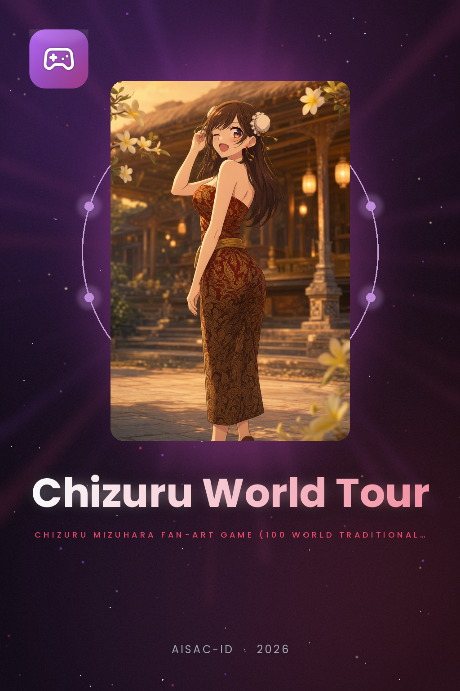
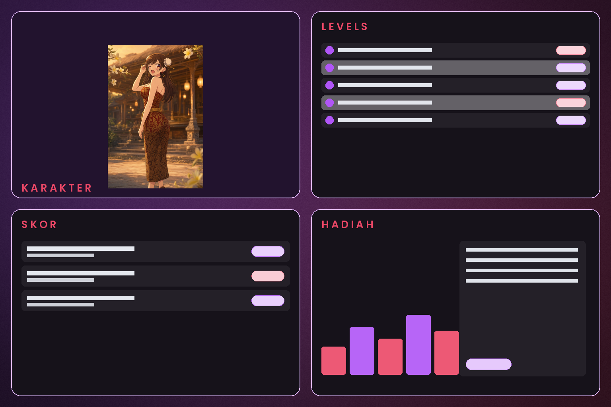
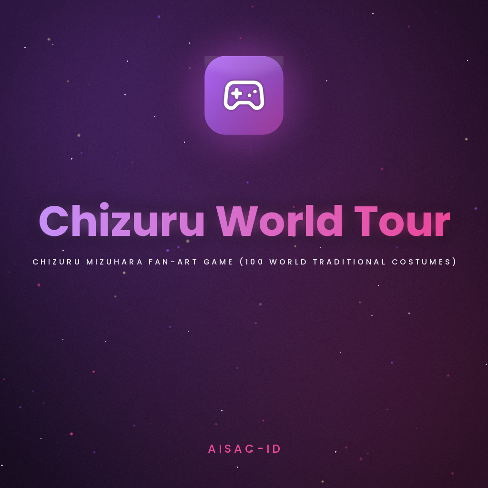

# Chizuru World Tour

  

Visual novel pendek: jalan-jalan keliling dunia bareng Chizuru Mizuhara dalam 8 destinasi kostum adat.

## Cara Main
- Baca dialog, buat pilihan yang menaikkan/menurunkan affection.
- 8 destinasi terbuka berurutan; affection menentukan ending (TRUE / GOOD / NORMAL).
- Progres disimpan di browser (localStorage).

## Mainkan
https://aisac-id.github.io/chizuru-world-tour/

## Teknis
Static HTML + JS, tanpa server. Buka `index.html` langsung atau via GitHub Pages.

---

## Brand & Promotion Kit

Aset branding resmi **Chizuru World Tour** — logo, software box, poster, banner, dan materi sosial.
Semua aset berada di folder [`promo/`](promo/) dan bebas dipakai untuk materi promosi proyek ini.

  

| Aset | Pratinjau | Ukuran |
|---|---|---|
| Logo |  | 1024×1024 |
| Wordmark |  | 1600×500 |
| Software Box |  | 1600×1200 |
| Poster |  | 1200×1600 |
| Banner |  | 1920×820 |
| Social Preview |  | 1280×640 |
| Feature Showcase |  | 1600×1000 |
| Social Square |  | 1080×1080 |
